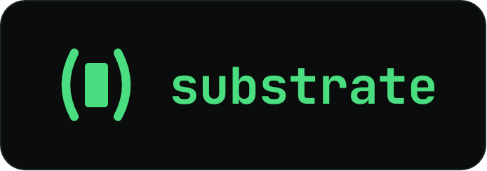

# 

Substrate is a Lisp for writing WebAssembly. It has C-like semantics
combined with Racket-style hygienic macros and module hooks for defining
new languages and DSLs. Its compiler is self-hosted (~11k LOC, ~600 KiB
of Wasm), fast, and runs in the browser. Substrate's dev tooling, package
manager, and standard library are also entirely written in Substrate.

Try Substrate on [substrate-lang.com](https://substrate-lang.com).

## Install

```sh
npm install -g substrate-lang
```

This installs the `substrate` command.

## Running Substrate

`hello.sub`:

```racket
(define (main) (printf "Hello, world!\n"))
```

`substrate run` builds the program and runs it:

```console
$ substrate run hello.sub
Hello, world!
```

To build and run in separate steps:

```console
$ substrate build hello.sub -o build/hello
$ substrate run build/hello
Hello, world!
```

Substrate code is sandboxed and cannot access your filesystem or network 
without grants. For example:

```racket
;; cat.sub: a program that prints a file
(require-unqualified host/fs)

(define (main)
  (let ([path (@ (host-args) 0)] [contents (slice u8)] [err error])
    (unless (fs-read-file path (& contents) (& err))
      (host-exit 1 (error-text (& err))))
    (printf "~a" (cast string contents))))
```

`@` reads an element of a slice, or what a pointer points to, `&` takes a
variable's address, and `unless` runs its body if its test is false.

```console
$ substrate run cat.sub hello.sub
hello.sub: reading is not granted (--allow-read)
$ substrate run -R=hello.sub cat.sub hello.sub
(define (main) (printf "Hello, world!\n"))
$ substrate run -A cat.sub hello.sub
(define (main) (printf "Hello, world!\n"))
```

The grants are similar to Deno's. `-R`, `-W`, `-N` and `-E` grant reading, writing,
the network and environment variables, and `--allow-run` grants running
programs. Each can be limited to a list after `=`, as in `-R=hello.sub`. `-A`
grants everything.

A program can also run in a browser. For example:

```racket
;; page.sub: put a heading on the page with std/web
(require-unqualified std/web/dom)

(define (main)
  (dom-add! (dom-template "<h1>Hello, world!</h1>") 0 0)
  (dom-flush!))
```

`substrate site` builds a site which `substrate serve` can serve locally:

```console
$ substrate site page.sub -o build/page
$ substrate serve build/page
http://127.0.0.1:8000/
```

These examples are in [examples/hello](examples/hello).

## Core Language

[examples/core.sub](examples/core.sub) uses structs, variants, numbers,
booleans, strings, slices and closures:

```racket
(struct point [x i32] [y i32])

(variant shape [square [side i32]] [rect [w i32] [h i32]])

(define (area [s shape]) -> i32
  (match s
    [(square side) (* side side)]
    [(rect w h) (* w h)]))

(define (largest [items (slice i32)]) -> i32
  (let ([best (@ items 0)])
    (for ([i u32 1]) (< i (-> items length)) (+= i 1)
      (when (> (@ items i) best) (set! best (@ items i))))
    best))

(define (count-if [items (slice i32)] [keep (closure (i32) -> bool)]) -> u32
  (let ([n u32 0])
    (for ([i u32 0]) (< i (-> items length)) (+= i 1)
      (when (keep (@ items i)) (+= n 1)))
    n))

(define (main)
  (let ([p (point #:x 3 #:y 4)])
    (printf "point: ~a, ~a\n" (-> p x) (-> p y)))
  (printf "areas: ~a, ~a\n" (area (square 3)) (area (rect 6 7)))
  (let ([ok bool #t] [half f32 0.5] [third f64 (/ 1.0 3.0)] [byte u8 255])
    (+= byte 1)
    (printf "bool: ~a, f32: ~a, f64: ~a, u8 255 + 1: ~a\n" ok half third byte))
  (let ([name "Substrate"])
    (printf "~a has ~a bytes and starts with ~a\n" name (-> name length) (slice name 0 3)))
  (printf "largest: ~a\n" (largest (slice (array-of i32 3 9 4))))
  (let* ([limit 4] [above (lambda ([x i32]) -> bool (> x limit))] [xs (slice (array-of i32 3 9 4 7))])
    (printf "above 4: ~a, " (count-if xs above))
    (set! limit 8)
    (printf "above 8: ~a\n" (count-if xs above)))
  (let ([xs (slice (array-of i32 1 2 3))])
    (printf "~a\n" (@ xs 3))))
```

Integers wrap around when they overflow (like Wasm) so the `u8` holding 255
holds 0 after `(+= byte 1)`. Dividing an integer by zero traps.

Closures (`lambda`) can access the variables of enclosing functions.
A closure can be passed to a call or kept in a local, but can't be returned 
or stored in memory.

Above, the last line reads past the end of a slice, so the program traps there:

```console
$ substrate run core.sub
point: 3, 4
areas: 9, 42
bool: #t, f32: 0.5, f64: 0.3333333333333333, u8 255 + 1: 0
Substrate has 9 bytes and starts with Sub
largest: 9
above 4: 2, above 8: 1
error: trap: index 3 is out of range for length 3
    at index-trap compiler/substrate.sub:243:5
    at main ./core.sub:37:20
```

## Standard Library

The standard library mostly holds modules useful for developing Substrate
itself, which may evolve before 1.0. Its modules, by directory:

- `std/string`: searching, trimming and building strings
- `std/encoding`: Base64, JSON, UTF-8 and postcard wire messages
- `std/crypto`: SHA-1, SHA-256, SHA-512, HMAC, HKDF and PBKDF2
- `std/compress`: DEFLATE and gzip
- `std/archive`: reading tar archives
- `std/http`: an HTTP/1.1 server, with routes, cookies, forms, sessions,
  server-sent events and WebSockets
- `std/web`: the page's DOM, canvas drawing and WebGPU
- `std/html`: writing HTML
- `std/log`: structured logs
- `std/vector`: growable arrays
- `std/meta`: types as data at compile time
- `std/test`: the test runner, and tests in a browser
- `std/browser`: Chromium, driven over the DevTools protocol
- `std/package`: manifests, package hashes and the package store
- `std/doc`: documentation from source, as text or HTML

[examples/json.sub](examples/json.sub) uses `std/encoding/json`, whose `json`
macro gives a struct a JSON reader and writer:

```racket
(require-unqualified std/encoding/json)

(struct release [name string] [version string] [tags (slice string)])

;; Derive JSON from the struct, using the standard library's json macro
(json release)

(define (main)
  (let ([a (make-arena)] [r release] [err json-error] [b (make-buffer)])
    (if (release.json-read (& a) "{\"name\": \"substrate\", \"version\": \"0.11.2\", \"tags\": [\"lisp\", \"wasm\"]}"
                           (& r) (& err))
        (begin
          (printf "~a ~a has ~a tags\n" (-> r name) (-> r version) (-> r tags length))
          (set! (-> r version) "1.0.0")
          (release.json-write! (& b) (& r))
          (printf "~a\n" (buffer-string (& b))))
        (printf "~a\n" (error-text (& (-> err error)))))))
```

```console
$ substrate run json.sub
substrate 0.11.2 has 2 tags
{"name":"substrate","version":"1.0.0","tags":["lisp","wasm"]}
```

## Packages

A package is a folder with a `package.sub`, or a program whose first form is
its manifest. A dependency is the path of a folder, or the URL of a tar.gz
archive, pinned by a hash of its files. `substrate fetch` prints the dependency
for a URL, with its hash:

```console
$ substrate fetch https://github.com/substrate-lang/example-package/archive/refs/tags/v0.1.0.tar.gz
substrate: fetching https://github.com/substrate-lang/example-package/archive/refs/tags/v0.1.0.tar.gz
(example-package (url "https://github.com/substrate-lang/example-package/archive/refs/tags/v0.1.0.tar.gz") (hash "sha256:6f07dd7bf3effd4fbe20233479401fa63b1ec37567645401fcbf4c744df44105"))
```

[examples/packages/greeting.sub](examples/packages/greeting.sub) depends on it:

```racket
(package greeting
  (version "0.1.0")
  (dependencies
   (example-package (url "https://github.com/substrate-lang/example-package/archive/refs/tags/v0.1.0.tar.gz")
                    (hash "sha256:6f07dd7bf3effd4fbe20233479401fa63b1ec37567645401fcbf4c744df44105"))))

(require example example-package)

(define (main) (example:banner "Hello from a package"))
```

Building it fetches the dependency into `build/packages`:

```console
$ substrate build greeting.sub -o build/greeting
substrate: fetching https://github.com/substrate-lang/example-package/archive/refs/tags/v0.1.0.tar.gz
$ substrate run build/greeting
+----------------------+
| Hello from a package |
+----------------------+
```

## Languages and Metaprogramming

A macro is a function that runs at compile time and turns syntax into syntax.
Macros are hygienic: the `tmp` that `swap!` introduces is different from the
caller's `tmp`. They are also sandboxed at compile time, which ensures compiler
determinism and system safety. [examples/swap.sub](examples/swap.sub):

```racket
(require-unqualified compiler/macros)
(begin-for-syntax (require-unqualified compiler/macros))

(define-macro (swap! stx)
  (syntax-match stx
    [(_ a b) #`(let ([tmp #,a]) (set! #,a #,b) (set! #,b tmp))]))

(define (main)
  (let ([tmp 1] [other 2])
    (swap! tmp other)
    (printf "~a ~a\n" tmp other)))
```

```console
$ substrate run swap.sub
2 1
```

Languages are packages too. [examples/bend2/proof.sub](examples/bend2/proof.sub)
is written in bend2, a port of [Bend 2](https://github.com/bendlang/bend) whose
type checker runs at compile time. Like the original, bend2's values are
affine, and its runtime frees them by reference counting, without a tracing
garbage collector. Here, we prove by induction that adding zero to a number
gives the number back:

```racket
(package proof
  (version "0.1.0")
  (dependencies
   (bend2 (url "https://github.com/substrate-lang/substrate-bend2/archive/refs/tags/v0.11.0.tar.gz")
          (hash "sha256:15d07c4ff74c44ed3aacafd5535cda6bd6a71b1579f49be7a9909e14e99d51e1"))))

(language bend2)

(type N Data [Z] [S [p : N]])

(law (add [a : N] [b : N]) N)
(def (add a b)
  (match a
    [Z b]
    [(S p) (S (add p b))]))

(law (add_zero [a : N]) (== (add a Z) a N))
(def (add_zero a)
  (match a
    [Z refl]
    [(S p) (rewrite (add_zero p) (== (S (add p Z)) (S _) N) refl)]))

(define (main) (print (add (S (S Z)) (S Z))))
```

```console
$ substrate run proof.sub
substrate: fetching https://github.com/substrate-lang/substrate-bend2/archive/refs/tags/v0.11.0.tar.gz
(S (S (S Z)))
```

A false claim does not compile. [examples/bend2/false.sub](examples/bend2/false.sub)
has the same type and `add`, and claims that 2 + 1 is 2:

```racket
(law (two_plus_one) (== (add (S (S Z)) (S Z)) (S (S Z)) N))
(def (two_plus_one) refl)
```

```console
$ substrate build false.sub -o build/false
false.sub:18:21: error: bend: expected (S (S (S Z)))
  observed (S (S Z))
  in: refl
```

## Memory Management

Memory is managed by hand, as in C. Locals live on the stack, and `&` gives
their address. `malloc` and `free` manage the heap, arenas free many
allocations at once, and buffers grow as they are written. `new` allocates
from an arena: `(new a T)` gives a zeroed object, and `(new a value)` gives an
object that holds the value. `copy` copies a string or a slice into an arena.
[examples/memory.sub](examples/memory.sub):

```racket
(struct node [value i32] [next (ptr node)])

(define (main)
  (let ([n (cast (ptr node) (malloc (sizeof node)))])
    (set! (-> n value) 7)
    (printf "malloc: ~a\n" (-> n value))
    (free n))
  (let ([a (make-arena)] [list (ptr node) 0])
    (for ([i 1]) (<= i 1000) (+= i 1)
      (set! list (new (& a) (node #:value i #:next list))))
    (printf "arena: ~a ~a ~a\n" (-> list value) (-> list next value) (-> list next next value))
    (arena-free (& a)))
  (let ([b (make-buffer)])
    (buffer-add-string! (& b) "grows ")
    (buffer-add-string! (& b) "as needed")
    (printf "buffer: ~a\n" (buffer-string (& b)))
    (buffer-free! (& b))))
```

```console
$ substrate run memory.sub
malloc: 7
arena: 1000 999 998
buffer: grows as needed
```

The core also has `calloc`, `realloc`, `memcpy`, `memset`, `memcmp` and hash
tables. `malloc` traps when memory runs out, where `try-malloc` gives 0, and
freeing a block twice traps.

Note that languages built as libraries on top of Substrate do not necessarily
need to manage memory manually (e.g.,
[bend2](https://github.com/substrate-lang/substrate-bend2)) as they can
implement their own runtimes.

## Concurrency

A program runs on one thread, with an event loop: timers, network requests,
sockets and streams report back as events, which the program handles one at a
time. For parallel work, a program starts workers. A worker runs one of the
program's own functions on its own thread, and it shares only messages with the
program. A worker can be given fewer grants than the program, and limits on its
time and memory. The playground on substrate-lang.com runs programs on workers.
[examples/workers.sub](examples/workers.sub):

```racket
(require worker host/worker)
(require events host/events)

(define (fib [n i32]) -> i32 (if (< n 2) n (+ (fib (- n 1)) (fib (- n 2)))))

(define (work) (printf "fib 32 = ~a\n" (fib 32)))

(define (finished [source u32] [kind u32] [id u32] [tag (ptr void)] [value i32])
  (when (== kind worker:worker-done) (worker:worker-stop id)))

(define (main)
  (events:event-handler! worker:worker-source finished)
  (worker:worker-start work (cast (slice u8) "") 0 0 0 0)
  (printf "main goes on while the worker works\n"))
```

```console
$ substrate run workers.sub
main goes on while the worker works
fib 32 = 2178309
```

## Linking Wasm Libraries

A Substrate program can link a library that another language compiled to a Wasm
side module, as clang and Emscripten produce. The library and the program's
Substrate code share one memory, so each can hand the other a pointer instead of
a copy. The library cannot call the host. It can call only Substrate's `malloc`,
`calloc`, `realloc` and `free`, and the Substrate functions that the program
gives it with `supply`. So it reaches files and the network only through
Substrate code, under the program's grants.
[substrate-sqlite](https://github.com/substrate-lang/substrate-sqlite) links
SQLite this way: [sqlite.sub](https://github.com/substrate-lang/substrate-sqlite/blob/main/sqlite.sub)
is the binding, and [vfs.sub](https://github.com/substrate-lang/substrate-sqlite/blob/main/vfs.sub)
gives SQLite a file layer written in Substrate.

## Testing

`substrate test` runs a package's tests. [examples/hello](examples/hello) is a
package:

```racket
(package hello
  (version "0.1.0")
  (tests "tests/*.sub" (browser)))
```

`(browser)` says that some of its tests open a browser. `tests/square.sub`
tests the function in `square.sub`:

```racket
(provide square)

(define (square [n i32]) -> i32 (* n n))
```

```racket
(require-unqualified "../square.sub")

(test square (expect-equal (square 7) 49))
```

`tests/page.sub` opens `page.sub` in Chromium:

```racket
(require-unqualified std/test/browser)

(test page
  (with-browser (b "../page.sub")
    (expect-text b (by-css "h1") "Hello, world!")))
```

```console
$ substrate test -v
ok hello/tests/page.sub:3 page
ok hello/tests/square.sub:3 square
hello: 2 passed (0.2 s)
```

Browser tests need Chrome or Chromium. Without either, `substrate test` skips
them.

## Performance

Substrate compiles code at ~47k lines per second, and its programs run within
about 1.4× of C compiled to Wasm. The compiler builds itself in about
a quarter of a second.

On realistic workloads, Substrate takes 0.35–1.4× the time of C compiled to
Wasm with clang -O2. Some of this is due to different algorithms and allocation
strategies, but these are common C libraries. Here we show Substrate's libraries
against C libraries, as Substrate's time over C's, on an AMD Ryzen 9 9950X with Node
24 on Linux:

| Workload              | Against | Substrate / C |
| --------------------- | ------- | ------------: |
| JSON parsing          | cJSON   |     0.35–0.96 |
| SHA-256, HMAC, PBKDF2 | mbedTLS |     0.79–1.39 |
| Deflate and inflate   | zlib    |     0.74–1.23 |

[bench/bench.md](bench/bench.md) has every result and how to run the benchmarks.

## Supported Platforms

Substrate runs on macOS, Linux and Windows, and CI runs its tests on all three.
Its host is Node 22 (22.22.3 or newer), Node 24 (24.15 or newer) or Node 25 or
newer. We chose Node (V8) as the first host, but nothing blocks a Wasmtime host
in the future.

## Contributing

Code may be written with LLMs. Text in pull requests, comments and docs must be
written by humans.

The toolchain comes from the Nix flake. In its dev shell (`nix develop`):

```sh
bin/substrate    # the substrate command, built from this checkout
make check       # the tests, then make docs when they pass
make bootstrap   # the compiler builds itself into the same bytes
make seed        # the bootstrap check, then the compiler and substrate become the seed
make docs        # documentation of the toolchain, as HTML in build/doc
make npm         # the npm package, packed into build and tried in a temporary install
```
