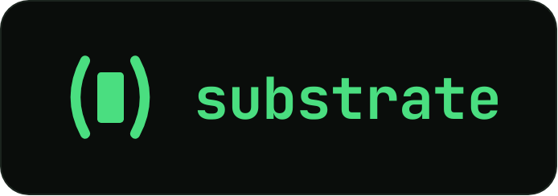

# 

Substrate is a Lisp for writing WebAssembly. It has C-like semantics
combined with Racket-style hygienic macros and module hooks for defining
new languages and DSLs. Its compiler is self-hosted (~12k LOC, ~600 KiB
of Wasm), fast, and runs in the browser. Substrate's dev tooling, package
manager, and standard library are also entirely written in Substrate.

Try Substrate and view additional examples on
[substrate-lang.com](https://substrate-lang.com), which is also written
entirely in Substrate (both frontend and backend, source
[here](https://github.com/substrate-lang/substrate-website)).

Note: this README was written by a human.

## Install

```sh
npm install -g substrate-lang
```

This installs the `substrate` command.

## Running Substrate

```racket
;; hello.sub
(define (main) (printf "Hello, world!\n"))
```

`substrate run` builds the program and runs it:

```console
$ substrate run hello.sub
Hello, world!
```

You can also build and run in separate steps:

```console
$ substrate build hello.sub -o build/hello
$ substrate run build/hello
Hello, world!
```

Substrate code is sandboxed and cannot access your filesystem or network
without grants. For example:

```racket
;; cat.sub: a program that prints a file
(require-unqualified host/fs)

(define (main)
  (let ([path (@ (host-args) 0)] [contents (slice u8)] [err error])
    (unless (fs-read-file path (& contents) (& err))
      (host-exit 1 (error-text (& err))))
    (printf "~a" (cast string contents))))
```

`@` reads an element of a slice, `&` takes an address, and `unless`
runs its body if its test is false.

```console
$ substrate run cat.sub hello.sub
hello.sub: reading is not granted (--allow-read)
$ substrate run -R=hello.sub cat.sub hello.sub
(define (main) (printf "Hello, world!\n"))
$ substrate run -A cat.sub hello.sub
(define (main) (printf "Hello, world!\n"))
```

Substrate's grants are similar to Deno's. `-R`, `-W`, `-N` and `-E` grant
reading, writing, network access, and environment variables, and `--allow-run`
allows running programs. Grants can be further restricted with `=`, as
in `-R=hello.sub`. `-A` grants everything.

A program can also run in a browser. For example:

```racket
;; page.sub: put a heading on the page with std/web
(require-unqualified std/web/dom)

(define (main)
  (dom-add! (dom-template "<h1>Hello, world!</h1>") 0 0)
  (dom-flush!))
```

`substrate serve` builds it and serves it locally:

```console
$ substrate serve page.sub
http://127.0.0.1:8000/
```

These examples are in [examples/hello](examples/hello).

## Core Language

[examples/core.sub](examples/core.sub) uses structs, variants, numbers,
booleans, strings, slices and closures:

```racket
(struct point [x i32] [y i32])

(variant shape [square [side i32]] [rect [w i32] [h i32]])

(define (area [s shape]) -> i32
  (match s
    [(.square side) (* side side)]
    [(.rect w h) (* w h)]))

(define (largest [items (slice i32)]) -> i32
  (let ([best (@ items 0)])
    (for ([i u32 1]) (< i (-> items length)) (+= i 1)
      (when (> (@ items i) best) (set! best (@ items i))))
    best))

(define (count-if [items (slice i32)] [keep (closure (i32) -> bool)]) -> u32
  (let ([n u32 0])
    (for ([i u32 0]) (< i (-> items length)) (+= i 1)
      (when (keep (@ items i)) (+= n 1)))
    n))

(define (main)
  (let ([p (point #:x 3 #:y 4)])
    (printf "point: ~a, ~a\n" (-> p x) (-> p y)))
  (printf "areas: ~a, ~a\n" (area (.square 3)) (area (.rect 6 7)))
  (let ([ok bool #t] [half f32 0.5] [third f64 (/ 1.0 3.0)] [byte u8 255])
    (+= byte 1)
    (printf "bool: ~a, f32: ~a, f64: ~a, u8 255 + 1: ~a\n" ok half third byte))
  (let ([name "Substrate"])
    (printf "~a has ~a bytes and starts with ~a\n" name (-> name length) (slice name 0 3)))
  (printf "largest: ~a\n" (largest (slice (array-of i32 3 9 4))))
  (let* ([limit 4] [above (lambda ([x i32]) -> bool (> x limit))] [xs (slice (array-of i32 3 9 4 7))])
    (printf "above 4: ~a, " (count-if xs above))
    (set! limit 8)
    (printf "above 8: ~a\n" (count-if xs above))))
```

```console
$ substrate run core.sub
point: 3, 4
areas: 9, 42
bool: #t, f32: 0.5, f64: 0.3333333333333333, u8 255 + 1: 0
Substrate has 9 bytes and starts with Sub
largest: 9
above 4: 2, above 8: 1
```

Integers wrap when they overflow (like Wasm), so a `u8` of 255
gives 0 after `(+= byte 1)`.

Variant cases are written with a dot and can infer type from the surrounding
code; for example `(area (.square 3))` makes a `shape`, because `area` takes
an input of type `shape`. Where inference is not possible (e.g., in `printf`)
you must name the type with `(shape .square 3)`.

Closures (`lambda`) can access the variables of enclosing functions.
A closure can be passed to a call or kept in a local, but can't be returned
or stored in memory.

## Errors, Exceptions, and Traps

In Substrate, most functions that can fail follow a C-like convention with
results written via a pointer, success or failure indicated by the return value
(`#t` or `#f`), and descriptions of failure in an additional `error` argument,
as `fs-read-file` does in the earlier `cat.sub` example. Alternatively,
exceptions support unwinding through many calls and are used by the compiler
for errors in macro expansion; they are slower, so they are best avoided for
error handling in performance-sensitive code. Finally, some core operations trap
with fatal errors, like a panic in Rust (e.g., reading past the end of a slice,
or dividing an integer by zero). [examples/errors.sub](examples/errors.sub)
shows all three:

```racket
(exception negative i32)

(define (item [items (slice i32)] [i u32] [out (ptr i32)] [err (ptr error)]) -> bool
  (when (>= i (-> items length)) (return (error-fail! err error-invalid "no such item")))
  (set! (@ out) (@ items i))
  #t)

(define (check [x i32]) (when (< x 0) (throw negative x)))

(define (check-all [items (slice i32)])
  (for ([i u32 0]) (< i (-> items length)) (+= i 1)
    (check (@ items i))))

(define (main)
  (let ([xs (slice (array-of i32 1 -2 3))] [x i32 0] [err error])
    (unless (item xs 3 (& x) (& err))
      (printf "failed: ~a\n" (error-text (& err))))
    (try (check-all xs)
      [catch negative (n) (printf "caught: ~a is negative\n" n)])
    (printf "~a\n" (@ xs 3))))
```

```console
$ substrate run errors.sub
failed: no such item
caught: -2 is negative
error: trap: index 3 is out of range for length 3
    at index-trap compiler/substrate.sub:243:5
    at main ./errors.sub:20:20
```

## Standard Library

The standard library mostly holds modules useful for developing Substrate's
tooling (e.g., build tools, package manager, testing framework), and may
evolve before 1.0. Its modules, by directory:

- `std/string`: searching, trimming and building strings
- `std/encoding`: Base64, JSON, UTF-8 and postcard wire messages
- `std/crypto`: SHA-1, SHA-256, SHA-512, HMAC, HKDF and PBKDF2
- `std/compress`: DEFLATE and gzip
- `std/archive`: reading tar archives
- `std/http`: an HTTP/1.1 server, with routes, cookies, forms, sessions,
  server-sent events and WebSockets
- `std/web`: DOM, canvas drawing, and WebGPU
- `std/html`: writing HTML
- `std/log`: structured logs
- `std/vector`: growable arrays, `(vector T)`
- `std/sort`: sorting slices
- `std/meta`: types as data at compile time, generic types and functions,
  and methods
- `std/test`: the test runner, and tests in a browser
- `std/browser`: Chromium, driven over the DevTools protocol
- `std/package`: manifests, package hashes and the package store
- `std/doc`: documentation from source, as text or HTML

Notably, the compiler bootstraps itself on a smaller language core in its
prelude and does not use the standard library.

Below, [examples/json.sub](examples/json.sub) shows how to use
`std/encoding/json`, which provides a `json` macro that can give a struct or
variant a JSON reader and writer:

```racket
(require-unqualified std/encoding/json)

(struct release [name string] [version string] [tags (slice string)])

;; Derive JSON from the struct, using the standard library's json macro
(json release)

(define (main)
  (let ([a (make-arena)] [r release] [err json-error] [b (make-buffer)])
    (if (release.json-read (& a) "{\"name\": \"substrate\", \"version\": \"0.12.0\", \"tags\": [\"lisp\", \"wasm\"]}"
                           (& r) (& err))
        (begin
          (printf "~a ~a has ~a tags\n" (-> r name) (-> r version) (-> r tags length))
          (set! (-> r version) "1.0.0")
          (release.json-write! (& b) (& r))
          (printf "~a\n" (buffer-string (& b))))
        (printf "~a\n" (error-text (& (-> err error)))))))
```

```console
$ substrate run json.sub
substrate 0.12.0 has 2 tags
{"name":"substrate","version":"1.0.0","tags":["lisp","wasm"]}
```

## Packages

Substrate packages are defined via a `package.sub` in a program's folder, or a
package declaration of the same form inside a single-file program.
Dependencies can be declared by path or by a hash-pinned URL of a tar.gz
archive.

For example, `substrate fetch` can print the dependency for a URL, with its
hash:

```console
$ substrate fetch https://github.com/substrate-lang/example-package/archive/refs/tags/v0.1.0.tar.gz
substrate: fetching https://github.com/substrate-lang/example-package/archive/refs/tags/v0.1.0.tar.gz
(example-package (url "https://github.com/substrate-lang/example-package/archive/refs/tags/v0.1.0.tar.gz") (hash "sha256:6f07dd7bf3effd4fbe20233479401fa63b1ec37567645401fcbf4c744df44105"))
```

Then [examples/packages/greeting.sub](examples/packages/greeting.sub) depends
on it:

```racket
(package greeting
  (version "0.1.0")
  (dependencies
   (example-package (url "https://github.com/substrate-lang/example-package/archive/refs/tags/v0.1.0.tar.gz")
                    (hash "sha256:6f07dd7bf3effd4fbe20233479401fa63b1ec37567645401fcbf4c744df44105"))))

(require example example-package)

(define (main) (example:banner "Hello from a package"))
```

Building it fetches the dependency into `build/packages`:

```console
$ substrate build greeting.sub -o build/greeting
substrate: fetching https://github.com/substrate-lang/example-package/archive/refs/tags/v0.1.0.tar.gz
$ substrate run build/greeting
+----------------------+
| Hello from a package |
+----------------------+
```

## Languages and Metaprogramming

A macro is a function that runs at compile time and rewrites syntax.
Macros are hygienic: the `tmp` that `swap!` introduces is different from the
caller's `tmp`. They are also sandboxed at compile time, which ensures compiler
determinism and system safety. [examples/swap.sub](examples/swap.sub):

```racket
(require-unqualified compiler/macros)
(begin-for-syntax (require-unqualified compiler/macros))

(define-macro (swap! stx)
  (syntax-match stx
    [(_ a b) #`(let ([tmp #,a]) (set! #,a #,b) (set! #,b tmp))]))

(define (main)
  (let ([tmp 1] [other 2])
    (swap! tmp other)
    (printf "~a ~a\n" tmp other)))
```

```console
$ substrate run swap.sub
2 1
```

Languages use macros and module hooks to provide new abstractions and custom
runtimes beyond what Substrate provides in its core. For example,
[examples/bend2/proof.sub](examples/bend2/proof.sub) is written in bend2, a
port of [Bend 2](https://github.com/bendlang/bend) with a dependent type
checker that runs at compile time. Like the original Bend 2, the values in its
Substrate port are affine, and its runtime frees them by reference counting,
without a tracing garbage collector. Here, we prove by induction that adding
zero to a number gives the number back:

```racket
(package proof
  (version "0.1.0")
  (dependencies
   (bend2 (url "https://github.com/substrate-lang/substrate-bend2/archive/refs/tags/v0.11.0.tar.gz")
          (hash "sha256:15d07c4ff74c44ed3aacafd5535cda6bd6a71b1579f49be7a9909e14e99d51e1"))))

(language bend2)

(type N Data [Z] [S [p : N]])

(law (add [a : N] [b : N]) N)
(def (add a b)
  (match a
    [Z b]
    [(S p) (S (add p b))]))

(law (add_zero [a : N]) (== (add a Z) a N))
(def (add_zero a)
  (match a
    [Z refl]
    [(S p) (rewrite (add_zero p) (== (S (add p Z)) (S _) N) refl)]))

(define (main) (print (add (S (S Z)) (S Z))))
```

```console
$ substrate run proof.sub
substrate: fetching https://github.com/substrate-lang/substrate-bend2/archive/refs/tags/v0.11.0.tar.gz
(S (S (S Z)))
```

A false claim does not compile. [examples/bend2/false.sub](examples/bend2/false.sub)
has the same type and `add`, and claims that 2 + 1 is 2:

```racket
(law (two_plus_one) (== (add (S (S Z)) (S Z)) (S (S Z)) N))
(def (two_plus_one) refl)
```

```console
$ substrate build false.sub -o build/false
false.sub:18:21: error: bend: expected (S (S (S Z)))
  observed (S (S Z))
  in: refl
```

## Generics

Substrate macros can work with types at compile time. Among other things, this
allows generics to be implemented as standard library code. Below,
[examples/types.sub](examples/types.sub) defines a `pair` of any two types, and
a `largest` for slices of any type that `>` can compare:

```racket
(require-unqualified std/meta/generic)
(require-unqualified std/sort)
(require-unqualified std/vector)

(define-generic (pair A B)
  (struct [first A] [second B]))

(define-generic ((largest T) [items (slice T)]) -> T
  (let ([best (@ items 0)])
    (for ([i u32 1]) (< i (-> items length)) (+= i 1)
      (when (> (@ items i) best) (set! best (@ items i))))
    best))

(typedef entry (pair string u32))

(define (main)
  (let ([v (vector entry)])
    (vector-push! (& v) (entry #:first "apples" #:second 3))
    (vector-push! (& v) (entry #:first "pears" #:second 5))
    (sort! (vector-items (& v)) (a b) (> (-> a second) (-> b second)))
    (vector-each ([e (& v)]) (printf "~a: ~a\n" (-> e first) (-> e second)))
    (vector-free! (& v)))
  (printf "~a\n" (largest (slice (array-of u32 3 9 4))))
  (printf "~a\n" (largest (slice (array-of f64 0.5 2.5)))))
```

```console
$ substrate run types.sub
pears: 5
apples: 3
9
2.5
```

Here `(vector T)` is a generic type defined in the standard library, and
`sort!` is a macro in front of a generic function.

## Memory Management

Memory is managed by hand in base Substrate, like C. Locals live on the stack,
and `&` gives their address. `malloc` and `free` manage the heap, and arenas
allow you to free many allocations at once. `new` allocates from an arena:
`(new a T)` gives a zeroed object, and `(new a value)` gives an object that
holds the provided value. `copy` copies a string or a slice into an arena.
Buffers grow as they are written.
[examples/memory.sub](examples/memory.sub):

```racket
(struct node [value i32] [next (ptr node)])

(define (main)
  (let ([n (cast (ptr node) (malloc (sizeof node)))])
    (set! (-> n value) 7)
    (printf "malloc: ~a\n" (-> n value))
    (free n))
  (let ([a (make-arena)] [list (ptr node) 0])
    (for ([i 1]) (<= i 1000) (+= i 1)
      (set! list (new (& a) (node #:value i #:next list))))
    (printf "arena: ~a ~a ~a\n" (-> list value) (-> list next value) (-> list next next value))
    (arena-free (& a)))
  (let ([b (make-buffer)])
    (buffer-add-string! (& b) "grows ")
    (buffer-add-string! (& b) "as needed")
    (printf "buffer: ~a\n" (buffer-string (& b)))
    (buffer-free! (& b))))
```

```console
$ substrate run memory.sub
malloc: 7
arena: 1000 999 998
buffer: grows as needed
```

The core also has `calloc`, `realloc`, `memcpy`, `memset`, `memcmp` and hash
tables. `malloc` traps when memory runs out, while `try-malloc` gives 0.
Freeing a block twice also traps.

Note that languages built as libraries on top of Substrate do not necessarily
need to manage memory manually (e.g.,
[bend2](https://github.com/substrate-lang/substrate-bend2)) as they can
implement their own runtimes.

## Concurrency

Programs run on one thread with an event loop: timers, network requests,
sockets and streams come back as events, which the program handles one at a
time. For parallel work, a program can start workers. A worker will run a
function on its own thread, and shares only messages with the parent program.
A worker can also be given fewer grants than the program.

For example, [examples/workers.sub](examples/workers.sub):

```racket
(require worker host/worker)
(require events host/events)

(define (fib [n i32]) -> i32 (if (< n 2) n (+ (fib (- n 1)) (fib (- n 2)))))

(define (work) (printf "fib 32 = ~a\n" (fib 32)))

(define (finished [source u32] [kind u32] [id u32] [tag (ptr void)] [value i32])
  (when (== kind worker:worker-done) (worker:worker-stop id)))

(define (main)
  (events:event-handler! worker:worker-source finished)
  (worker:worker-start work (cast (slice u8) "") 0 0 0 0)
  (printf "main goes on while the worker works\n"))
```

```console
$ substrate run workers.sub
main goes on while the worker works
fib 32 = 2178309
```

## Linking Wasm Libraries

A Substrate program can link a library that another language compiled to Wasm.
Libraries linked this way cannot call the host. For example,
[substrate-sqlite](https://github.com/substrate-lang/substrate-sqlite) links
SQLite this way: [sqlite.sub](https://github.com/substrate-lang/substrate-sqlite/blob/main/sqlite.sub)
is the binding, and [vfs.sub](https://github.com/substrate-lang/substrate-sqlite/blob/main/vfs.sub)
gives SQLite a file layer written in Substrate.

## Testing

`substrate test` runs a package's tests. [examples/testing](examples/testing) is
a package:

```racket
(package testing
  (version "0.1.0")
  (tests "tests/*.sub")
  (dev-dependencies (chromium)))
```

Here `(chromium)` says that some of its tests open Chromium, which
`substrate test` will drive. Then `tests/square.sub` tests the function in
`square.sub`:

```racket
(provide square)

(define (square [n i32]) -> i32 (* n n))
```

```racket
(require-unqualified "../square.sub")

(test square (expect-equal (square 7) 49))
```

`tests/page.sub` opens `page.sub` in Chromium:

```racket
(require-unqualified std/test/browser)

(test page
  (with-browser (b "../page.sub")
    (expect-text b (by-css "h1") "Hello, world!")))
```

```console
$ substrate test -v
ok testing/tests/page.sub:3 page
ok testing/tests/square.sub:3 square
testing: 2 passed (0.2 s)
```

## Performance

Substrate compiles code at ~47k lines per second, and its programs run within
about 1.4× of C compiled to Wasm on like-for-like benchmarks. The compiler
builds itself in about a quarter of a second.

On larger workloads, Substrate takes 0.35–1.4× the time of C compiled to Wasm
with clang -O2. Some of this is due to different algorithms and allocation
strategies, but we largely modeled our code after the common C libraries we
used as reference. Here we show a comparison on an AMD Ryzen 9 9950X with
Node 24 on Linux.

| Workload              | Against | Substrate / C |
| --------------------- | ------- | ------------: |
| JSON parsing          | cJSON   |     0.35–0.96 |
| SHA-256, HMAC, PBKDF2 | mbedTLS |     0.79–1.39 |
| Deflate and inflate   | zlib    |     0.74–1.23 |

[bench/bench.md](bench/bench.md) has every result and how to run the benchmarks.

## Supported Platforms

Substrate runs on macOS, Linux and Windows (this repo's CI tests on all three).
Substrate's host requires Node 22 (22.22.3 or newer), Node 24 (24.15 or newer)
or Node 25 or newer. We chose Node (V8) as the first host, but nothing blocks a
Wasmtime host in the future.

## Contributing

Code may be written with LLMs. Text in pull requests, comments and docs must be
written by humans.

The toolchain comes from the Nix flake. In its dev shell (`nix develop`):

```sh
bin/substrate    # the substrate command, built from this checkout
make check       # the tests, then make docs when they pass
make bootstrap   # the compiler builds itself into the same bytes
make seed        # the bootstrap check, then the compiler and substrate become the seed
make docs        # documentation of the toolchain, as HTML in build/doc
make npm         # the npm package, packed into build and tried in a temporary install
```
